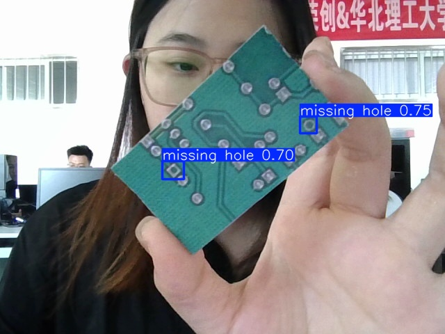
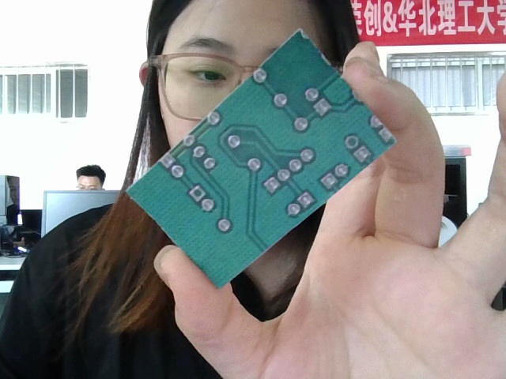
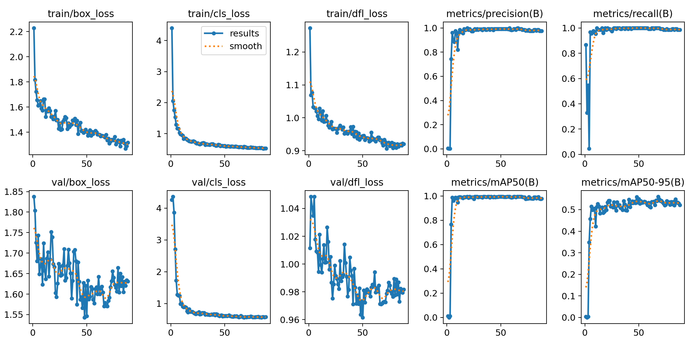
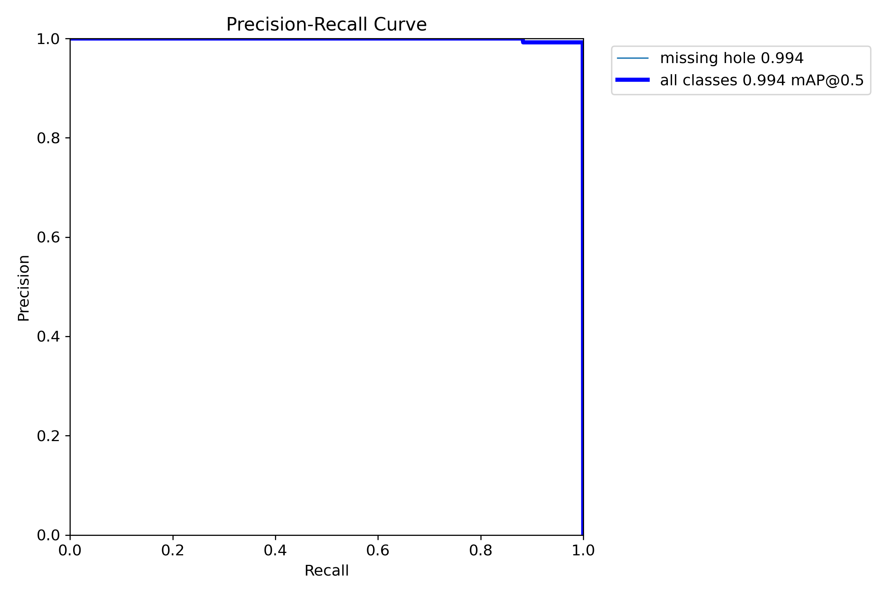
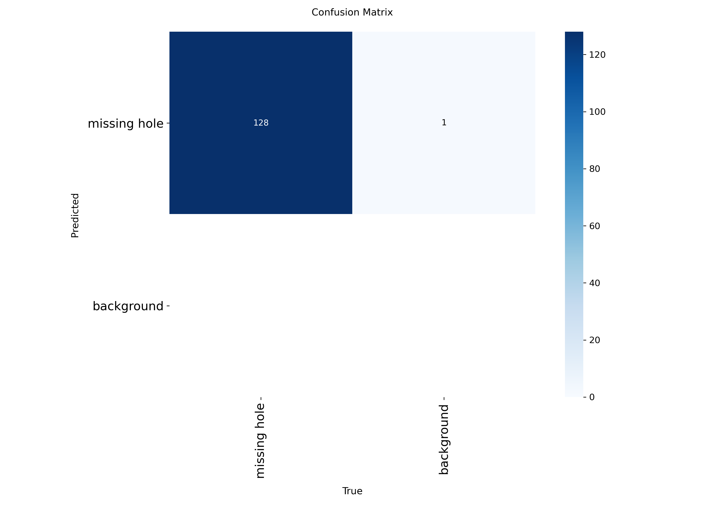
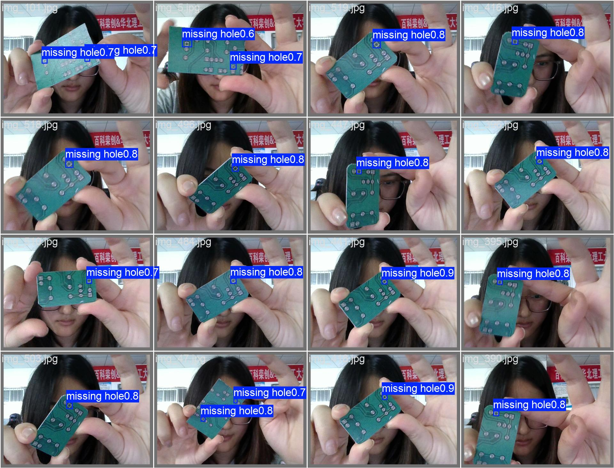

# PCB Defect Detection with YOLOv8n · 基于 YOLOv8 的 PCB 电路板缺陷检测

**English —** An end-to-end industrial inspection project that detects **missing-hole defects on PCB boards** using YOLOv8n. I built the entire pipeline myself: image acquisition → annotation → augmentation design → training → evaluation → integration into a desktop application. On a self-built dataset (**394 images / 619 annotated boxes**), the model reaches **Precision 0.991 · Recall 1.000 · mAP@50 0.994** at **~1.1 ms per image** (RTX 4060 Laptop). Code, dataset, training artifacts and evaluation curves are all open-sourced and reproducible. See [Key Design Decisions](#-关键设计决策) for why vertical flip was disabled and how `best.pt` was selected.

面向工业质检场景的 **PCB 缺失孔（missing hole）** 缺陷检测项目。
自主完成全链路：图像采集 → 数据标注 → 增强策略设计 → 模型训练调优 → 指标评估 → 集成到桌面应用。



> 本项目为华北理工大学人工智能学院「AI+行业赋能应用综合实习」（2026.09）成果，本人担任该课题负责人。

---

## 📊 结果

在自建数据集（**394 张图 / 619 个缺陷标注框**，按 8:2 划分为 315 训练 + 79 验证）上，
基于 **YOLOv8n**（imgsz=640, batch=16, epochs=100, patience=20）训练 88 轮，耗时 204 秒（RTX 4060 Laptop）。

| 指标 | 数值 | 说明 |
|---|---|---|
| **Precision** | **0.991** | 验证集 79 张 |
| **Recall** | **1.000** | **该验证集漏检为 0** |
| **mAP@50** | **0.994** | |
| mAP@50-95 | 0.560 | 严格 IoU 阈值下小目标定位精度仍有提升空间 |
| 推理速度 | ~1.1 ms/张 | RTX 4060 Laptop |

> ⚠️ 数据集为自采单一缺陷类型、背景可控，验证集规模有限。上述指标反映的是该条件下的结果，
> 泛化到多缺陷类别与复杂背景仍需进一步验证。

### 检测效果对比

| 原始图像 | 检测结果 |
|---|---|
|  |  |

### 训练曲线



### PR 曲线与混淆矩阵

| BoxPR 曲线 | 混淆矩阵 |
|---|---|
|  |  |

### 验证集预测可视化



---

## 🚀 快速开始

### 环境

```bash
pip install ultralytics opencv-python
```

推荐 Python 3.9+，训练建议使用 NVIDIA GPU。

### 跑检测

```bash
python code/predict.py
```

默认读取 `demo/原图/`，结果输出到 `demo/检测结果/`。也可指定其他图片或文件夹：

```bash
python code/predict.py --source "某张图.jpg"
python code/predict.py --source "某个文件夹" --conf 0.25
```

### 重新训练

```bash
python code/train.py
```

或直接用 Ultralytics 命令行：

```bash
yolo detect train data=dataset/data.yaml model=train_out/yolov8n.pt epochs=100 imgsz=640
```

> `data.yaml` 里的 `train` / `val` 使用相对路径，与 `images/`、`labels/` 同在 `dataset/` 目录下，
> 因此**整体移动目录也不会失效**。

### 重新划分数据集

```bash
python code/split_dataset.py
```

---

## 🧠 关键设计决策

- **`flipud=0` —— 主动关闭垂直翻转**
  PCB 板面具有方向性，上下翻转会产生物理上不成立的样本，因此关闭该增强。
- **单类小样本增强组合**
  启用 `mosaic` + `mixup` + `copy_paste`，在仅 394 张图的情况下扩充样本多样性。
- **早停策略**
  `patience=20`，在第 88 轮停止；`best.pt` 由 fitness（`0.1×mAP@50 + 0.9×mAP@50-95`）选出，对应第 68 轮。

---

## 📁 目录结构

```
pcb-defect-detection/
├── code/                        训练 / 推理 / 数据集划分脚本
│   ├── train.py
│   ├── predict.py
│   └── split_dataset.py
├── dataset/                     自建数据集（YOLO 格式）
│   ├── data.yaml
│   ├── images/{train,val}       394 张工业相机采集图像
│   └── labels/{train,val}       LabelImg 标注 → YOLO txt
├── train_out/                   Ultralytics 训练输出
│   ├── results.csv              逐轮完整指标
│   ├── results.png              训练曲线
│   ├── confusion_matrix.png     混淆矩阵
│   ├── BoxPR_curve.png          PR 曲线
│   ├── val_batch*_pred.jpg      验证集预测可视化
│   ├── last.pt / yolov8n.pt     最后一轮权重 / 预训练权重
│   └── args.yaml                训练参数记录
├── model/
│   └── best.pt                  最优权重，已集成进桌面检测平台
├── demo/
│   ├── 原图/                    23 张待检测图片
│   └── 检测结果/                对应检测结果（带框 + 置信度）
└── README.md
```

---

## ⚙️ 推理参数

`code/predict.py` 支持命令行调节：

| 参数 | 默认值 | 说明 |
|---|---|---|
| `--source` | `demo/原图` | 输入图片或文件夹 |
| `--conf` | 0.5 | 置信度阈值，调低更敏感（宁可错杀），调高更保守 |
| `--iou` | 0.7 | NMS 交并比阈值 |
| `--save-txt` | 关闭 | 加上则额外导出检测框坐标到 txt |

---

## 🔗 相关项目

本项目产出的 `best.pt` 已集成进本人独立开发的 **PyQt5 桌面检测平台**
（约 5500 行，支持图片 / 视频 / 摄像头三路检测，内置 24 个行业预训练模型，
具备 DPI 自适应、深浅主题切换、检测历史与 CSV 导出等功能）。

---

## 🙋 作者

段晓静 ｜ 华北理工大学 人工智能学院 · 2027 届 ｜ CET-4 478 / CET-6 443

- 数据集、训练脚本与全部可视化结果均为本人独立完成。
- 验证集逐轮指标可在 `train_out/results.csv` 中查证。
